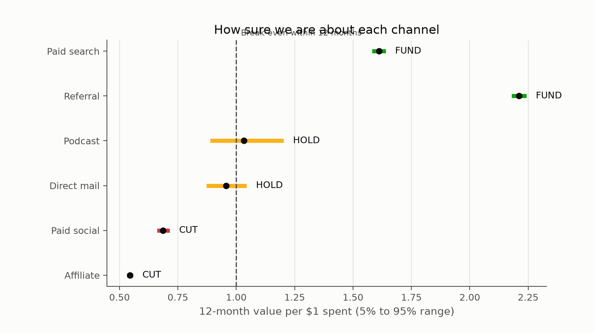
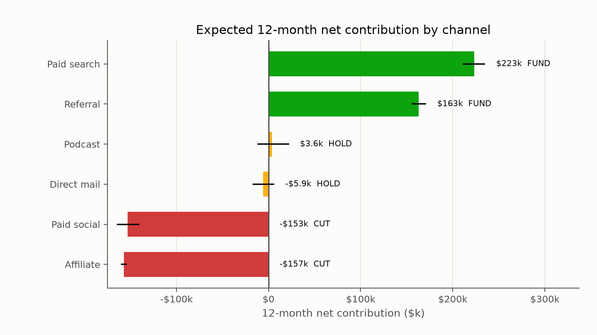
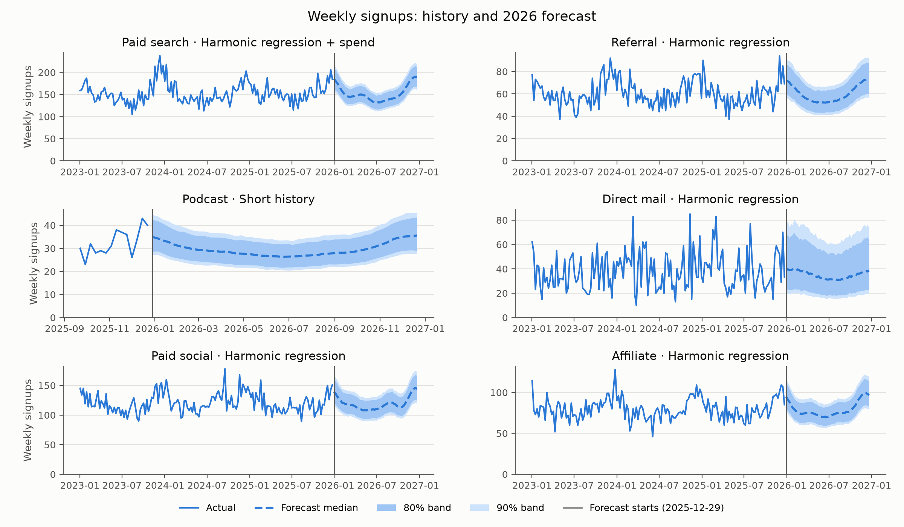
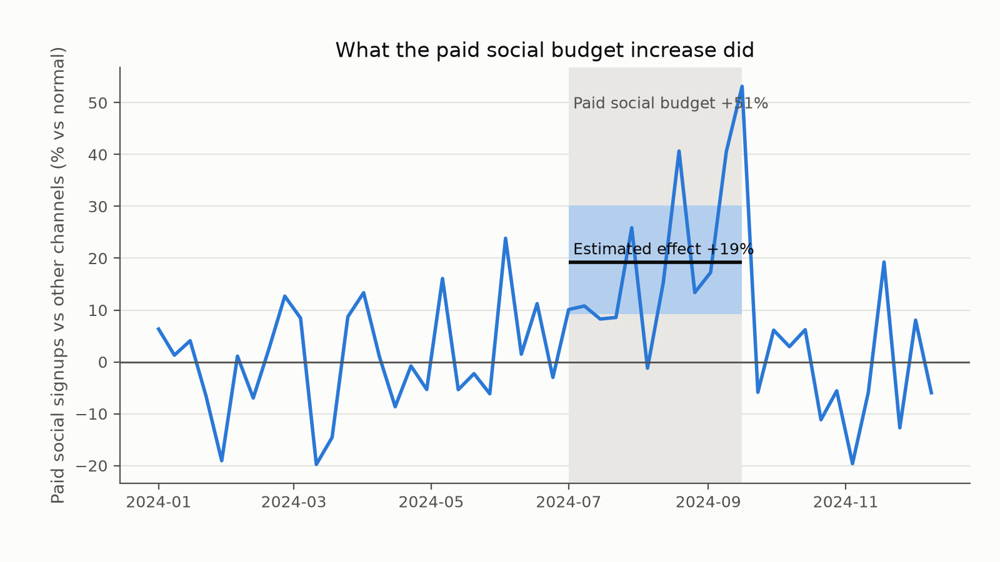
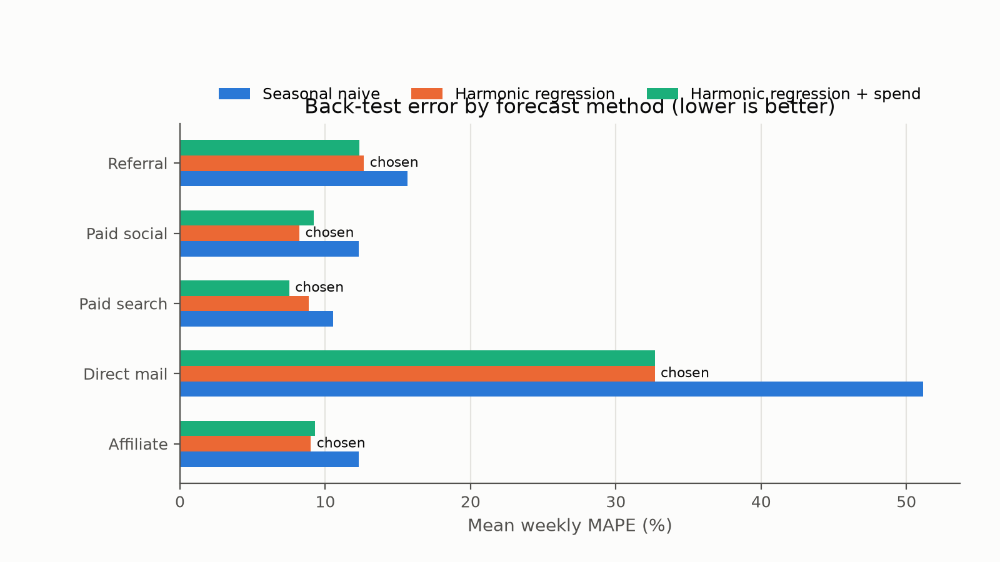
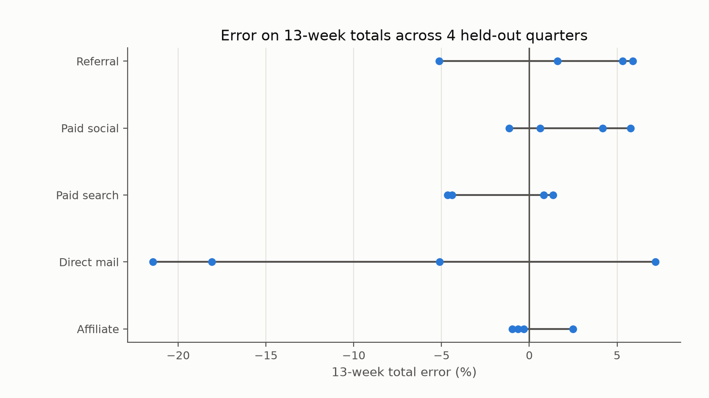
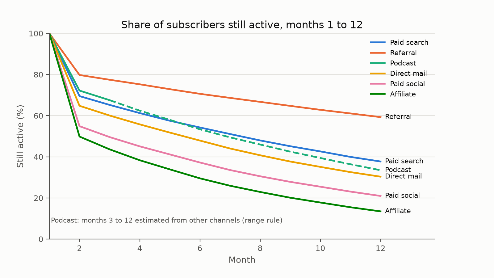
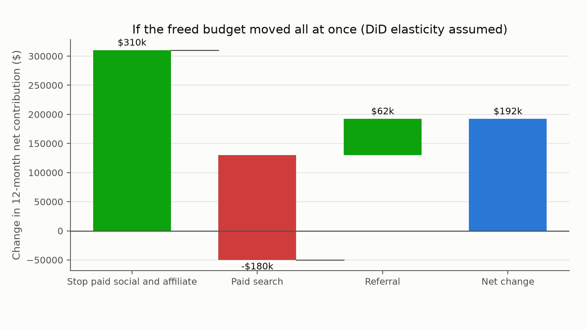

# Acquisition Channel Review: Which Channels a Subscription Retailer Should Fund, Cut or Hold

I studied a fictional coffee subscription retailer. Customers pay $30 a month for a box. I forecasted the next year of signups, estimated how long new customers stay, and compared that value with the cost of each acquisition channel. My call is to fund paid search and referral, cut paid social and affiliate, and hold podcast and direct mail until we have more evidence.

## The data is simulated

No public dataset has channel spend, channel signups, channel retention, and a past spend change for one business. I simulate the data and plant known effects so tests can check that the analysis finds them. I committed the analysis plan before any data existed. I do not change the rules after seeing results.

See [docs/analysis_plan.md](docs/analysis_plan.md), [docs/simulation_design.md](docs/simulation_design.md), and [docs/changelog.md](docs/changelog.md).

## Results

| Rank | Channel | Call | Value back per $1 (median) | 5% to 95% range | Median 12-month net | Payback |
| --- | --- | --- | --- | --- | --- | --- |
| 1 | Paid search | FUND | $1.61 | $1.58 to $1.64 | $223k | month 7 |
| 2 | Referral | FUND | $2.21 | $2.18 to $2.24 | $163k | month 5 |
| 3 | Podcast | HOLD | $1.03 | $0.89 to $1.20 | $3.6k | month 12 |
| 4 | Direct mail | HOLD | $0.96 | $0.87 to $1.04 | -$5.9k | over 12 months |
| 5 | Paid social | CUT | $0.69 | $0.66 to $0.72 | -$153k | over 12 months |
| 6 | Affiliate | CUT | $0.54 | $0.53 to $0.56 | -$157k | over 12 months |

In July to September 2024 the paid social budget rose by 51%. Signups rose about 19% compared with channels we did not change, with a likely range of 9% to 30%. Each extra signup cost about $178, versus about $79 for a normal signup. A fake earlier event and a check after spend went back to normal both sat near zero.

I back-tested three seasonal signup forecasts on four held-out 13-week quarters. The chosen methods and mean weekly errors were: paid search, harmonic regression with spend, 7.5%; paid social, harmonic regression, 8.2%; affiliate, harmonic regression, 9.0%; referral, harmonic regression, 12.7%; direct mail, harmonic regression, 32.7%. Podcast was too new for that back-test, so I used the short-history rule.

Podcast and direct mail stay on HOLD. Podcast has only 2 estimated months of retention history, and most later months use the range rule from other channels. It pays back if monthly cancellations after month 2 stay at or below 8.5%. Other channels range from 2.8% to 13.0%. Twelve months of history for the first podcast customers would settle that. Direct mail needs about 40 signups a week to break even. I expect about 38 (likely 34 to 43). A ZIP-code holdout pause, or two more quarters of data, would settle that.

If I stop paid social and affiliate, that frees about $541k of planned yearly media spend and adds about $310k in 12-month profit from stopping the losses. Moving that freed spend all at once into paid search and referral, in proportion to their current spend, and assuming they respond like paid social did, still leaves about $192k of net gain overall. That response size is an assumption borrowed from the paid social test. I would move the money in steps and test each step.

## Charts



Value back per $1 spent, with the likely range and the break-even line at $1.



Median 12-month net contribution, with low and high ends.



History and the 2026 signup forecast for each channel.



Paid social signups versus other channels around the 2024 spend increase.



Mean weekly forecast error by method. Lower is better.



13-week total error for the chosen method on each held-out quarter.



Median share of subscribers still active through month 12.



Stopping the cut channels and moving that spend to the fund channels.

## The readout

The stakeholder deck is [deck/readout.pptx](deck/readout.pptx) and [deck/readout.pdf](deck/readout.pdf).

1. Fund 2 channels, cut 2, hold 2 until we know more
2. Search and referral make money; social and affiliate lose it
3. How sure we are about each channel
4. Spending more on paid social did not pay
5. Two channels we cannot call yet, and what would settle them

## How I did it

1. Simulate weekly spend and signups for six channels, plus subscriber histories, with planted effects and a fixed seed.
2. Build a monthly retention life table in DuckDB SQL, then draw 2,000 values of 12-month value per subscriber.
3. In R, back-test three seasonal signup models on four held-out quarters and pick one method per channel.
4. In R, refit the chosen model and simulate 2,000 future paths of 52 weeks. Short-history channels use a pooled seasonal pattern.
5. In R with fixest, estimate the paid social spend change against unaffected channels, with Newey-West standard errors, plus placebo and reversal checks.
6. In Python, pair signup draws with value draws, apply the fund, cut, and hold rules, and build the budget scenario.

## Run it yourself

You need uv, Python 3.12, and R with the packages forecast, fixest, dplyr, readr, and jsonlite.

```bash
bash scripts/run_all.sh
```

That syncs the Python environment, rebuilds the data and every analysis step, rebuilds the charts and deck, and runs the tests.

## Repo layout

```text
data/                 simulated inputs (weekly, subscribers, costs, planted truth)
docs/                 analysis plan, simulation design, changelog
r/                    back-test, final forecast, difference-in-differences
src/acr/              simulate, retention, decide, charts, deck
tests/                recovery and repo checks
outputs/tables/       all numeric results
outputs/figures/      charts used in the README and deck
deck/                 stakeholder readout
scripts/run_all.sh    full pipeline
```

## Limitations

The data is simulated. The response of paid search and referral to extra spend is borrowed from one paid social test. I treat each signup as fully caused by its named channel. Planned spend is held flat at the last 13 weeks. I only count 12-month value.

## What I would do next

I would wait for 12 months of podcast retention history. I would run a direct mail holdout that pauses mail in a random set of ZIP codes for 8 to 12 weeks. I would raise referral and paid search spend in steps and measure the response before moving the full freed budget.
